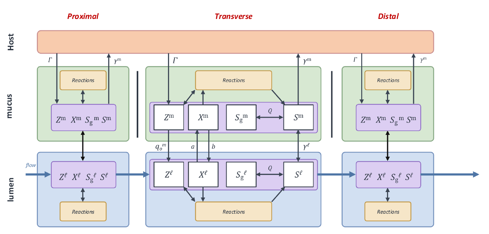
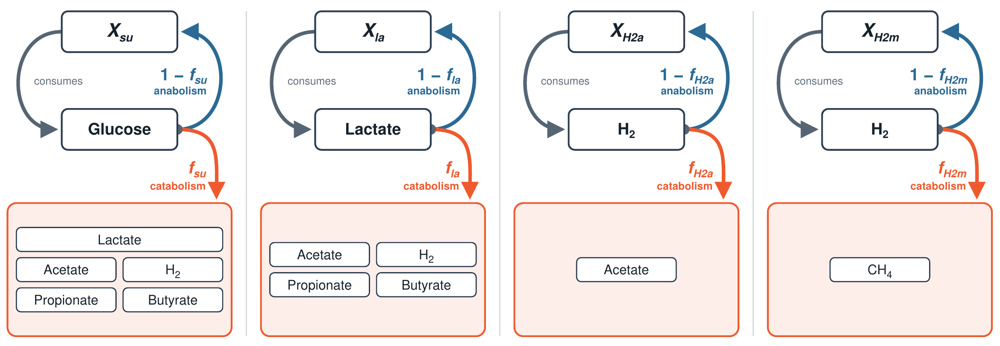
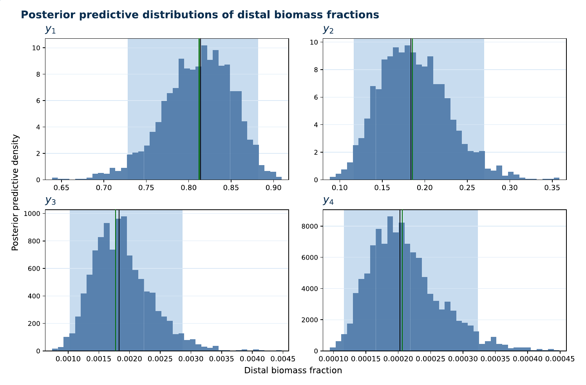

# Data Integration, Sensitivity Analysis and Inverse Problem Formulation for a Compartmental Colon Model

**MSc Thesis in Mathematical Engineering** · Politecnico di Milano · Academic year 2025–2026

**Author:** Michele Baggi
**Advisor:** Prof. Paola Francesca Antonietti (Politecnico di Milano, MOX)
**Co-advisors:** Béatrice Laroche, Lorenzo Sala (INRAE, MaIAGE, Université Paris-Saclay, Dynenvie team)
**Defence:** 21 October 2026

## Documents

| Document | Description |
| --- | --- |
| [Full thesis](docs/Baggi_MSc_Thesis.pdf) | Complete thesis manuscript |
| [Executive summary](docs/Baggi_MSc_Thesis_Executive_Summary.pdf) | 6-page summary of the thesis |
| [Presentation slides](docs/Baggi_MSc_Thesis_Presentation.pdf) | Slides from the thesis defence, with technical appendix |

---

## In short

The same diet can produce metabolic responses that differ by more than 100% from one person to another. The reason lies in the gut microbiota, but the inside of the colon cannot be observed: the only routine measurement is a **stool sample**, which tells us what leaves the colon, not what happens along the way.

This thesis connects a **mechanistic model of the colon** (a nonlinear system of 106 ODEs) with **3613 faecal metagenomes**, and tunes the model **sample by sample** so that it reproduces the microbial composition measured in each one. Each sample becomes a model that can be simulated and perturbed: a first step towards a per-patient **gut digital twin**.

The work was carried out at MaIAGE (INRAE, Université Paris-Saclay) in the Dynenvie team.

## Data and model

**Data.** Each faecal sample is sequenced (shotgun metagenomics). Keeping only the genes involved in fibre and mucin degradation gives 101 functional traits per sample, which are then summarised by non-negative matrix factorisation as the weights of **four functional profiles** (Labarthe et al., 2023). After cleaning, the dataset contains 3613 samples from healthy subjects and several disease groups.

**Model.** The reference model (Muñoz-Tamayo et al., 2010) describes anaerobic carbohydrate degradation along the colon: three regions in series (proximal, transverse, distal), each split into a lumen and a mucus layer, for six perfectly mixed compartments. A discrete reset at each excretion makes the system hybrid:

$$\dot{\mathbf{u}} = F(\mathbf{u}, \boldsymbol{\theta}, t), \qquad \mathbf{u} \in \mathbb{R}^{106}.$$

I re-implemented the model in Python and reproduced the results of the original Matlab version.

<p align="center">
  
</p>

Four bacterial groups ferment the substrates. For each group, a **catabolic fraction** $f$ of the consumed substrate becomes metabolites (short-chain fatty acids, H₂, CH₄), while the remainder $1-f$ becomes new biomass.

<p align="center">
  
</p>

## Method

The inverse problem asks: *which parameters make the model reproduce the composition observed in a given sample?* It is solved in four steps.

### 1. Match the model with the data

The profile weights and the model biomasses have no common unit, so only **relative compositions** are compared: the four biomasses in the distal lumen at excretion, normalised to sum to one, against the normalised profile weights $\mathbf{w}/\lVert\mathbf{w}\rVert_1$.

To make each functional profile correspond to one model state, the microbial groups were changed from *specialists* (one substrate each) to *generalists* that take part in several pathways, with fixed weights $\alpha = (0.5, 0.3, 0.2)$ and $\beta = (0.8, 0.2)$. Compositions are compared with the **Aitchison distance**, the Euclidean distance between centred log-ratio (clr) coordinates.

Other adaptations: a reduced bacterial inflow, a small positive adherence coefficient, a relative-variation stopping rule over a 30-day window, and a robustness check over 1000 perturbed initial conditions.

### 2. Global sensitivity analysis

The model has 60 parameters, but one composition carries only three independent numbers. Biological reasoning reduced them to 30 factors, **Morris screening** (1860 runs) kept 12, and **Sobol' indices** (53 248 runs) showed that the four catabolic fractions carry most of the output variance. These are the parameters inferred from then on:

$$\boldsymbol{\theta} = (f_{\mathrm{su}},\ f_{\mathrm{la}},\ f_{\mathrm{H_2a}},\ f_{\mathrm{H_2m}}).$$

### 3. Neural surrogate

One run of the full model takes several seconds, which is too slow inside MCMC. A multilayer perceptron (4 hidden layers × 128 units, softmax output so that the prediction is a composition) was trained on $2^{15} = 32\,768$ scrambled-Sobol' parameter vectors, using the squared Aitchison distance as loss. On the test set: median Aitchison error 0.012, 95th percentile 0.060, $R^2 > 0.998$ in clr coordinates.

### 4. Bayesian inversion

The parameters are not identifiable from one sample alone, so the problem is posed in Bayesian form. The likelihood is a Gaussian on the Aitchison distance between the surrogate prediction and the observation ($\sigma = 0.2$). The priors are truncated Gaussians on $[0.01, 0.99]$ centred on the reference values. The posterior is sampled with **DEMetropolis(Z)** in PyMC.

## Results

**One sample.** On the medoid of the cohort, six chains converge ($\hat{R} \le 1.002$, more than 7800 effective samples). All four observed fractions fall inside the 95% posterior predictive intervals.

<p align="center">
  
</p>

**The whole cohort.**

| | |
| --- | --- |
| Samples inverted | **3613 / 3613**, none failed (2 h 46 min on 64 cores) |
| Median distance model–data | **0.142** (full ODE model at the posterior median, 100 random samples) |
| Mean distance between subjects | **3.24** (to the cohort centre) |

The model reproduces each sample **an order of magnitude more closely** than subjects differ from each other.

**Interpretation.** A good fit does not make the parameters identifiable: a four-part composition has only three degrees of freedom, so many parameter vectors reproduce the same observation. The estimated fractions are not an individual's true biological values. What the inversion provides is a model configuration compatible with the data, which can be used to simulate quantities a stool sample does not measure, such as short-chain fatty acid production.

## Future work

- New measurements as extra constraints: short-chain fatty acids, total biomass, repeated samples, diet records.
- A richer representation of the metagenome than four profiles.
- The same workflow applied to richer models that distinguish between macronutrients.

## References

1. S. Labarthe, S. Plancade, S. Raguideau, F. Plaza Oñate, E. Le Chatelier, M. Leclerc, B. Laroche. *Four functional profiles for fibre and mucin metabolism in the human gut microbiome.* Microbiome, 11, 2023.
2. R. Muñoz-Tamayo, B. Laroche, É. Walter, J. Doré, M. Leclerc. *Mathematical modelling of carbohydrate degradation by human colonic microbiota.* Journal of Theoretical Biology, 266(2):189–201, 2010.
3. S. Raguideau, S. Plancade, N. Pons, M. Leclerc, B. Laroche. *Inferring aggregated functional traits from metagenomic data using constrained non-negative matrix factorization: application to fiber degradation in the human gut microbiota.* PLoS Computational Biology, 12(12):e1005252, 2016.
4. A. Saltelli, P. Annoni, I. Azzini, F. Campolongo, M. Ratto, S. Tarantola. *Variance based sensitivity analysis of model output. Design and estimator for the total sensitivity index.* Computer Physics Communications, 181(2):259–270, 2010.
5. C. J. F. ter Braak, J. A. Vrugt. *Differential evolution Markov chain with snooker updater and fewer chains.* Statistics and Computing, 18(4):435–446, 2008.

## Citation

If you use this work, please cite it as:

```bibtex
@mastersthesis{baggi2026colon,
  author = {Baggi, Michele},
  title  = {Data Integration, Sensitivity Analysis and Inverse Problem Formulation for a Compartmental Colon Model},
  school = {Politecnico di Milano},
  year   = {2026},
  type   = {MSc thesis in Mathematical Engineering}
}
```
